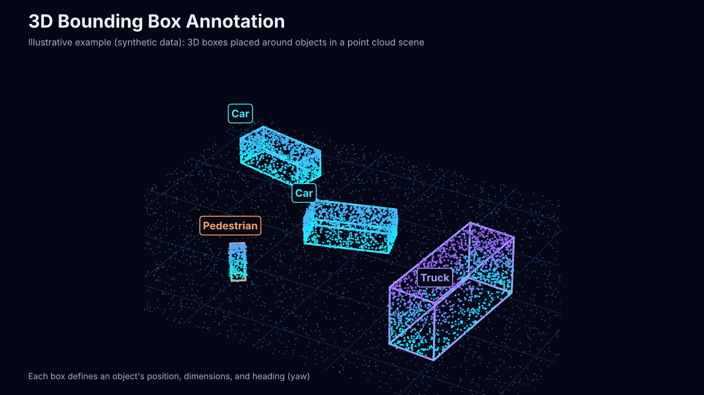

# 3D Bounding Box Annotation

## Project Overview

This project demonstrates 3D bounding box annotation for object detection and localization in 3D scenes.

The task involves identifying relevant objects and placing 3D bounding boxes around them to represent their position, dimensions, and orientation in a three-dimensional environment.

## Key Skills

- 3D Object Detection
- 3D Bounding Box Placement
- Object Localization
- Spatial Annotation
- Annotation Accuracy and Quality Control

## Annotation Example

