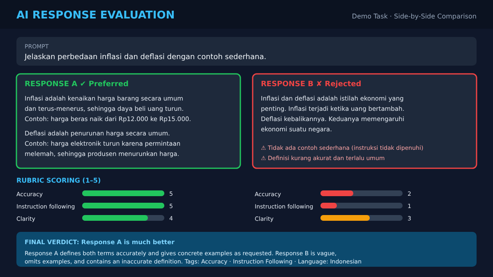

# AI Evaluation

  

## Project Overview

This section showcases hands-on experience in evaluating AI-generated responses and assessing output quality based on task-specific instructions and evaluation guidelines.

## Evaluation Activities

- AI-generated response evaluation
- Response quality assessment
- Instruction following evaluation
- Relevance and accuracy assessment
- Prompt and response analysis
- Content quality review

## Evaluation Criteria

AI-generated outputs are assessed based on:

- Accuracy and factual consistency
- Relevance to the given prompt
- Clarity and completeness
- Instruction compliance
- Overall response quality

## Objective

To support the development of reliable AI systems by identifying response quality issues and evaluating AI-generated content against defined criteria.
