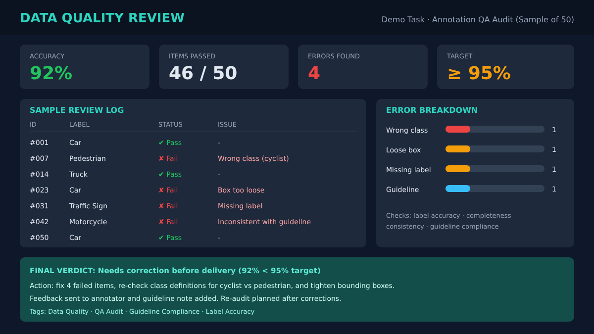

# Data Quality Evaluation

  

## Project Overview

This section showcases experience in reviewing and assessing data quality to ensure accuracy, consistency, completeness, and compliance with task-specific guidelines.

## Quality Assessment Activities

- Data accuracy review
- Annotation quality checking
- Consistency assessment
- Error identification
- Guideline compliance review
- Data validation

## Evaluation Criteria

- Accuracy and correctness
- Data consistency
- Completeness
- Labeling quality
- Guideline compliance

## Objective

To support reliable AI model development by identifying data issues and maintaining high-quality annotation and evaluation standards.
