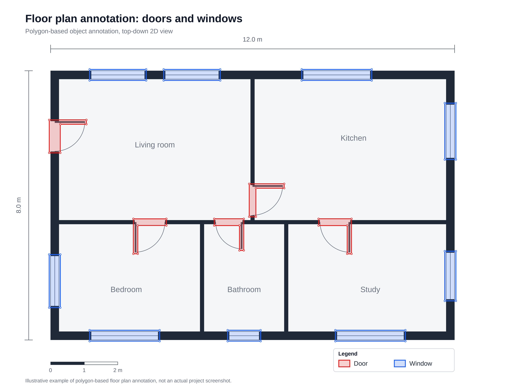

# FloorPlan Annotation

## Project Overview

This project involved floor plan annotation using the Labelbox platform.

## Tasks Performed

- Annotated floor plan elements.
- Identified and labeled relevant objects and areas.
- Followed project-specific annotation guidelines.
- Maintained annotation accuracy and consistency.
- Reviewed annotation results according to quality requirements.

## Tools

- Labelbox
- Image Annotation

## Skills Demonstrated

- Image Annotation
- Data Labeling
- Attention to Detail
- Instruction Following
- Data Quality Assessment
- ## Annotation Example

*Illustrative example of polygon-based door and window annotation. Not an actual project screenshot.*
