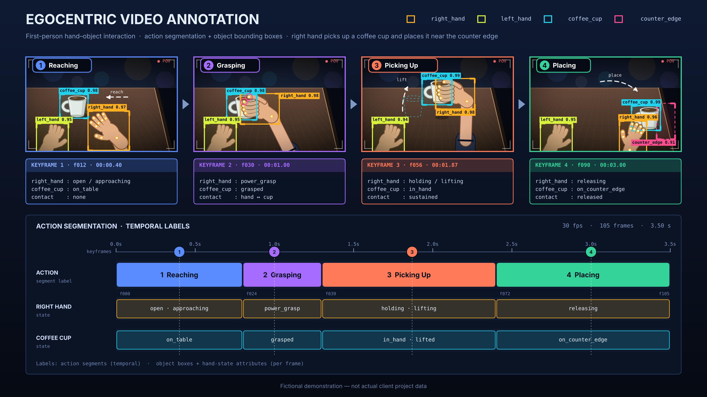

# Video Annotation Portfolio
## Egocentric / First-Person Video Annotation

This portfolio demonstrates my experience in first-person video annotation for AI training and evaluation.

## Visual Demonstration

*Illustrative example of first-person visual activity annotation.*

## Project Overview

Experience observing, identifying, and describing human activities from an egocentric camera perspective.

## Annotation Tasks

- Identifying human activities
- Describing actions and movements
- Recognizing objects and interactions
- Observing hand-object interactions
- Describing sequential activities
- Maintaining accurate and consistent annotations

## Sample Annotation

**Illustrative Example:**

"The person reaches forward with their right hand, picks up a cup from the table, and places it near the edge of the counter."

## Key Skills

- Egocentric Video Annotation
- First-Person Video Analysis
- Human Activity Recognition
- Object Interaction Description
- Action Sequence Annotation
- Attention to Detail
- Data Quality Assessment

## Project Experience

**Outlier Cribbage Tail – First-Person Video Annotation**

Experience working with first-person video examples and describing visual activities based on project guidelines.

## Quality Guidelines

- Accurate visual observation
- Consistent action descriptions
- Clear identification of objects and interactions
- Following project-specific annotation guidelines
- Attention to detail and data quality

## Portfolio Note

This documentation presents illustrative examples for demonstration purposes and does not contain confidential client data.
